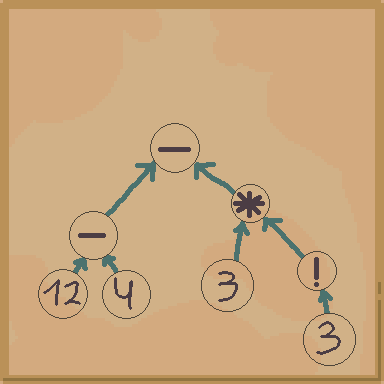

# GREP PROJECT

## P1 : 


2. Considérons l’automate A associé à une expression e qui ne fait pas intervenir de point. Combien de transitions sortantes étiquetées par une lettre un état de A peut-il posséder ? Et combien de transitions sortantes étiquetées par ε ? Peut-il posséder à la fois les deux types de transition sortante (étiquetée par une lettre et étiquetée par ε) ?

> un état peut contenir une seule transition sortante étiquetée par une lettre  
> un état peut contenir au plus deux epsilons $\varepsilon$ transitions  
> un état ne peut pas combiner ces deux dernières types de transitions.

Ceci on peut le justifier par inductions, avec le nombre de transitions sortantes par sommets et selon le type de transitions. Puis on le fait avec les constructions du cours. 


7.  Expliquer brièvement le fonctionnement de l’implémentation choisie pour les piles

```c
struct stack {
    int length;     // nombre d’éléments actuellement dans la pile
    int capacity;   // taille maximale de la pile
    nfa** data;     // tableau de pointeurs vers des automates NFA
};
```
On fait une pile qui contient des automates

```c
stack* stack_new(int capacity)
{
    stack* s = malloc(sizeof(stack));
    s->data = malloc(capacity * sizeof(nfa*));
    s->capacity = capacity;
    s->length = 0;
    return s;
}
```
On crée une pile sans rien, mais avec une capacité donné au debut

```c
nfa* pop(stack* s){
    assert(s->length > 0);
    nfa* result = s->data[s->length - 1];
    s->length--;
    return result;
}
```
On prends le dernier elements de la pile, et on actualise la taille

```c
void push(stack* s, nfa* a){
    assert(s->capacity > s->length);
    s->data[s->length] = a;
    s->length++;
}
```
On ajoute un element à la fin et on augmente la taille 


On a implementé une pile où la capacité est fixée dés le debut et ne sera jamais modifiée


8. Rappeler le principe de l’évaluation d’une expression arithmétique en notation postfixe en traitant l’exemple suivant : 12 4 - 3 3 ! * - où - et * sont des opérateurs binaires représentant la soustraction et la multiplication et ! est un opérateur unaire représentant la factorielle.

$$12 \; 4 \; - \; 33 \; ! \; * \; - $$



on peut traduire les calculs postfixe avec un le diagramme precedent et maintenant on peut réaliser le calcul comme une personne normale: 

$$\boxed{(12 - 4) - 3(3)! = -10}$$


10. Déterminer la complexité temporelle de build en fonction de la taille de son entrée

Pour commencer les operations `push`et `pop` sont en temps constants donc $\mathcal{O}(1)$ pour tous les deux

On lit chaque caractère de `regex` au plus une fois et pour chaque appel on fait un nombre limité de push et pop donc à chaque iteration on fait des $\mathcal{O}(1)$.

Donc on a un $\boxed{\mathcal{O}(n) \text{ avec n la taille la taille du mot}}$

11. Expliquer en moins de deux phrases le principe de fonctionnement de la fonction mystery. Quelle est la stratégie algorithmique qu’elle utilise ?

La fonction parcours récursivement avec du `backtracking` l'automate en tenant en compte les $\varepsilon-$transitions. A la fin on on renvoie `true` si le mot est acceptant `false` sinon.

13.  Le fichier de données français.txt fournit l’ensemble des mots de la langue française, un par ligne. Compiler votre code mygrep.c en exécutable mygrep et utiliser le pour déterminer tous les mots de la langue française qui contiennent à la fois un q et un w.

On a besoin de l'expression en notation infixe : 

$$ (\Sigma^* q \Sigma^* w \Sigma^*) + (\Sigma^* w \Sigma^* q \Sigma^*)$$

donc on obtient, avec le notation de l'énoncé et postfixe :
$$".*q@.*@w@.*@.*w@.*@q@.*@|"$$ 

```bash
$ ./mygrep ".*q@.*@w@.*@.*w@.*@q@.*@|" "francais.txt"

[...]

=== Lignes acceptées par l'expression : ".*q@.*@w@.*@.*w@.*@q@.*@|" ===
clownesque
clownesques
squaw
squaws
wisigothique
wisigothiques
```

14. Les fichiers aXXb.txt fournis contiennent chacun une unique ligne, constituée de XX caractères a suivis d’un unique caractère b. Mesurer le temps pris par le programme mygrep pour chercher dans ces fichiers une occurrence de l’expression (aa?)?. Que constate-t-on et comment l’expliquer ?

```bash 
time ./mygrep "aa?@*" "aXXb.txt"
```


$$\begin{array}{|c|c|}
\hline aXXb & time \\
\hline 20 & 0m0.011s \\
\hline 25 & 0m0.070s \\
\hline 30 & 0m0.210s \\
\hline 35 & 0m1.401s \\
\hline 40 & 0m14.914 \\ 
\hline
\end{array}
$$

on constate que ca n'augmente pas de manière linéaire. Le temps explose très rapidement. On peut expliquer cette augmentation parce que cet expression génère beaucoup de possibilités.   


15. Comparer ces temps avec ceux obtenus en utilisant grep

```bash 
time grep "(aa?)*" "aXXb.txt"
```


$$\begin{array}{|c|c|}
\hline aXXb & time \\
\hline 20 & 0m0.007s \\
\hline 25 & 0m0.008s \\
\hline 30 & 0m0.007s \\
\hline 35 & 0m0.009s \\
\hline 40 & 0m0.008s \\ 
\hline
\end{array}
$$

`grep` est assez efficient pour que tous les temps soient égaux et très inférieur à ceux de `mygrep`


16. Que se passe-t-il si on exécute notre programme mygrep avec l’expression (a?)? et un fichier non vide quelconque ? Expliquer d’où provient ce comportement et comment on pourrait le résoudre

```bash
$ time ./mygrep "a?*" "francais.txt"
1
1
1
=== Lignes acceptées par l'expression : "a?*" ===
Segmentation fault (core dumped)

real	0m1.339s 
user	0m0.010s
sys	0m0.028s
```

Ce problème apparaît sûrement dû au fait qu'on a beaucoup trop des $\varepsilon-$transitions en boucles donc on tourne nombreuses fois inutilement

On pourrait essayer de determiner l'automate mais malheureusement la determination peut donner un nouveau automate avec un nombre exponentielle d’états.


17. Le problème vient du fait que la fonction de libération parcourt récursivement les transitions sans tenir compte des cycles présents dans l’automate.

Comme certains états peuvent être accessibles par plusieurs chemins, la fonction essaie de libérer plusieurs fois les mêmes états


18. Proposer un algorithme qui permettrait de libérer correctement un objet de type nfa*. On ne demande pas d’implémentation, juste les grandes lignes de ce qu’on pourrait faire

La première idée pour résoudre ce problème et libérer tous les états sans qu'il y ait des dépendances, avec par exemple un parcours en profondeur.

On réalise un parcours en profondeur tous les sommets avec un ordre arbitraire (par exemple l'ordre croissant). et dès qu'on finit d'explorer on peut libérer ce morceau.  